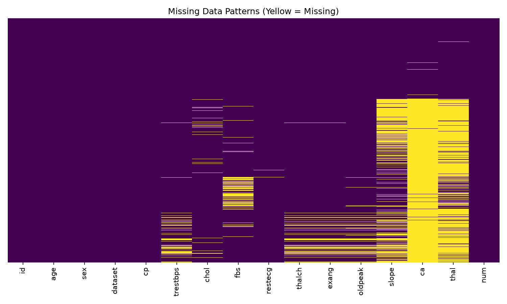
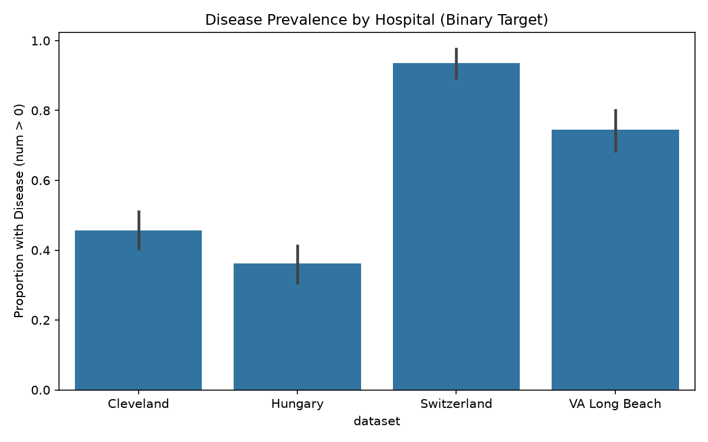
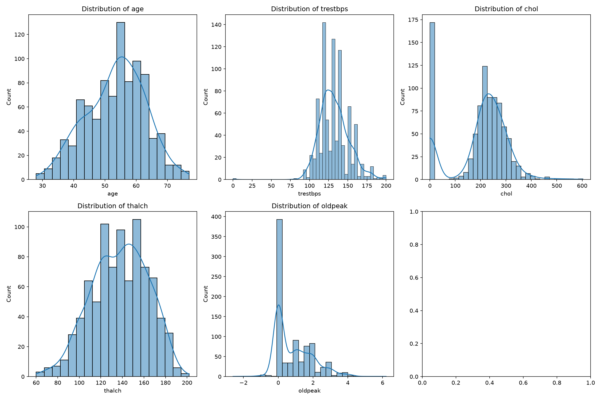
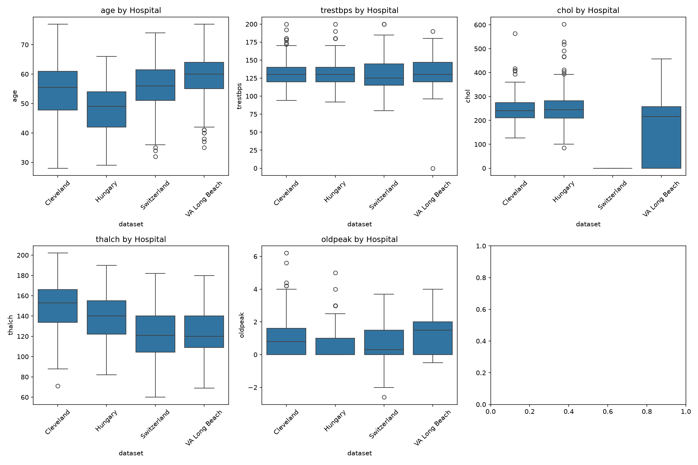
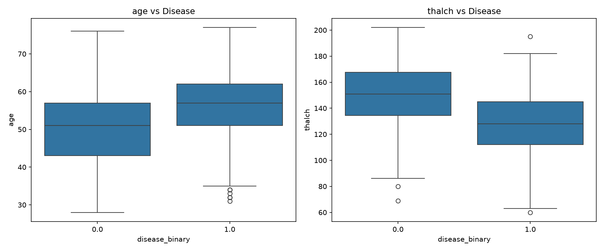
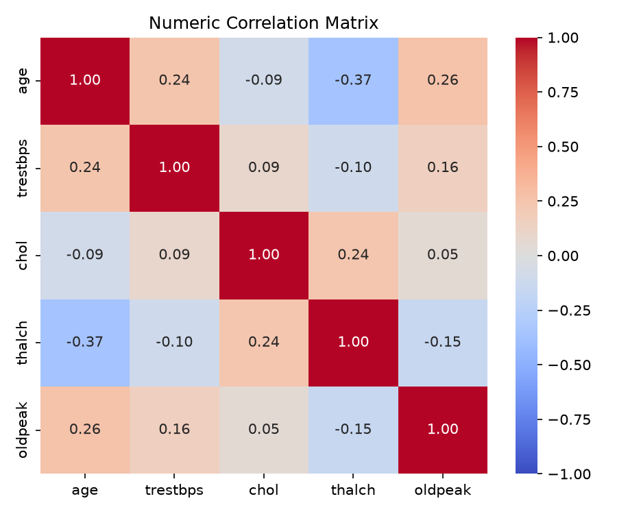

# Exploratory Data Analysis (EDA) Report
**Note:** This analysis is read-only. No data was modified.

## 1. Structure and Integrity
- **Row count:** 920
- **Columns:** 16 expected features + metadata.
- **ID Uniqueness:** PASS. `id` column is completely unique.
- **Duplicate Rows (ignoring ID):** 4 rows are duplicates.
- **Rows per hospital (`dataset`):**
  - Cleveland: 304
  - Hungary: 293
  - VA Long Beach: 200
  - Switzerland: 123

## 2. Missingness
### Missing Tokens Inventory
- **trestbps**: `''`: 59
- **chol**: `''`: 30
- **fbs**: `''`: 90
- **restecg**: `''`: 2
- **thalch**: `''`: 55
- **exang**: `''`: 55
- **oldpeak**: `''`: 62
- **slope**: `''`: 309
- **ca**: `''`: 611
- **thal**: `''`: 486
### Missingness per Hospital (%)

*Caption: Co-occurrence of missing values. Yellow lines indicate missing cells.*
| Dataset | id | age | sex | dataset | cp | trestbps | chol | fbs | restecg | thalch | exang | oldpeak | slope | ca | thal | num |
|---|---|---|---|---|---|---|---|---|---|---|---|---|---|---|---|---|
| Cleveland | 0.0 | 0.0 | 0.0 | 0.0 | 0.0 | 0.0 | 0.0 | 0.0 | 0.0 | 0.0 | 0.0 | 0.0 | 0.3 | 1.6 | 1.0 | 0.0 |
| Hungary | 0.0 | 0.0 | 0.0 | 0.0 | 0.0 | 0.3 | 7.8 | 2.7 | 0.3 | 0.3 | 0.3 | 0.0 | 64.5 | 99.0 | 90.4 | 0.0 |
| Switzerland | 0.0 | 0.0 | 0.0 | 0.0 | 0.0 | 1.6 | 0.0 | 61.0 | 0.8 | 0.8 | 0.8 | 4.9 | 13.8 | 95.9 | 42.3 | 0.0 |
| VA Long Beach | 0.0 | 0.0 | 0.0 | 0.0 | 0.0 | 28.0 | 3.5 | 3.5 | 0.0 | 26.5 | 26.5 | 28.0 | 51.0 | 99.0 | 83.0 | 0.0 |

*Note: High missingness in `ca`, `thal`, and `slope` is strongly clustered by hospital.*

## 3. Impossible and Suspicious Values
| Feature | Min | Max | Median | Suspicious Count | Notes |
|---------|-----|-----|--------|------------------|-------|
| age | 28 | 77 | 54.0 | 0 | Looks ok |
| trestbps | 0.0 | 200.0 | 130.0 | 1 | 1 zero/neg values |
| chol | 0.0 | 603.0 | 223.0 | 172 | 172 zero values |
| thalch | 60.0 | 202.0 | 140.0 | 0 | Looks ok |
| oldpeak | -2.6 | 6.2 | 0.5 | 12 | 12 negative values |

**Observation on Zeros:**
- `chol` zeros by hospital: {'Switzerland': 123, 'VA Long Beach': 49}
- *Interpretation: Zeros in cholesterol are biologically impossible and likely represent missing data encoding, isolated to specific hospitals.*

## 4. Category and Boolean Inventories
- **sex**: {'Male': 726, 'Female': 194}
- **cp**: {'asymptomatic': 496, 'non-anginal': 204, 'atypical angina': 174, 'typical angina': 46}
- **fbs**: {'FALSE': 692, 'TRUE': 138, '': 90}
- **restecg**: {'normal': 551, 'lv hypertrophy': 188, 'st-t abnormality': 179, '': 2}
- **exang**: {'FALSE': 528, 'TRUE': 337, '': 55}
- **slope**: {'flat': 345, '': 309, 'upsloping': 203, 'downsloping': 63}
- **thal**: {'': 486, 'normal': 196, 'reversable defect': 192, 'fixed defect': 46}
- **ca**: {'': 611, '0': 181, '1': 67, '2': 41, '3': 20}

**Notes on `ca`:**
- `ca` represents number of major vessels (0-3). Some sources treat it as numeric, but it represents discrete counts. The presence of blanks and its categorical nature in medical diagnosis suggests treating it as categorical or ordinal.

## 5. Target Analysis
- **`num` (0-4) Distribution:** {0: 411, 1: 265, 2: 109, 3: 107, 4: 28}
- *Levels 3 and 4 are rare. Formulating this as a binary task (0 vs >0) is likely more robust for modeling.*

*Caption: Proportion of sick patients per hospital. Notice the variance across sites.*

## 6. Numeric Distributions

*Caption: Histograms of continuous features.*

**Outlier counts (IQR rule):**
- `age`: 0 outliers
- `trestbps`: 28 outliers
- `chol`: 183 outliers
- `thalch`: 2 outliers
- `oldpeak`: 16 outliers

*Caption: Feature distributions separated by hospital source. `chol` zeros clearly skew specific hospitals.*

## 7. Feature vs Disease (Descriptive Only)
> **LEAKAGE WARNING:** These plots explore target relationships on the FULL dataset. They are descriptive only and MUST NOT be used for feature selection or encoding choices, as that would leak test-set information into the model design.

*Caption: Older age and lower max heart rate (`thalch`) correlate observationally with disease presence.*

*Caption: Linear correlation among continuous features.*

## 8. Hospital / Source Effect Summary
The 4 hospitals (Cleveland, Hungary, Switzerland, VA Long Beach) are heavily heterogeneous:
1. **Missingness:** `ca`, `thal`, and `slope` are almost entirely missing in Switzerland and VA Long Beach.
2. **Data conventions:** The fake `chol=0` values are isolated to Switzerland and VA Long Beach.
3. **Disease Rate:** Prevalence varies significantly across sites.

**Conclusion:** Pooling these sites blindly is risky. A standard random train/test split might learn hospital-specific quirks (like `chol=0`) instead of true physiological risk. A 'leave-one-hospital-out' cross-validation strategy would be robust to test generalization.
